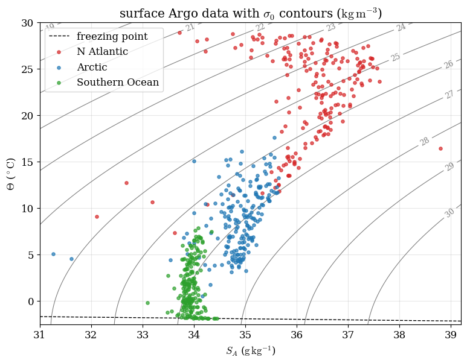
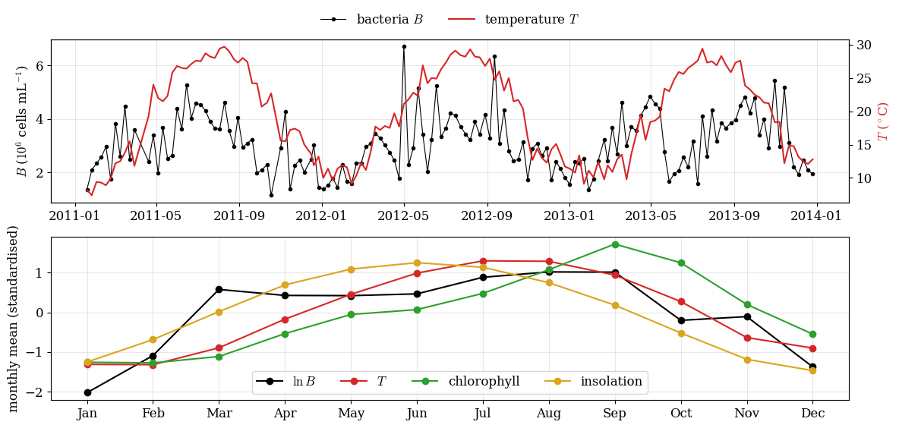

# Ocean Data Analysis

Two data analysis projects on real oceanographic data, written in Python as Jupyter notebooks for **OCES 3301** at HKUST. Each one starts from a scientific question, works through exploratory analysis and statistical testing, and ends with what the data can and can't support.

Both notebooks load their data remotely, so they run anywhere with an internet connection, including Colab.

| # | Project | Methods | Open |
|---|---------|---------|------|
| 1 | [Surface Argo data by basin: temperature, salinity and TEOS-10 density](notebooks/01_argo_surface_density.ipynb) | Descriptive stats, Pearson/Spearman correlation, Shapiro-Wilk, Levene, Welch's t-test, Mann-Whitney U, finite-difference derivatives of the equation of state | [](https://colab.research.google.com/github/weAOKSKDOKAS/ocean-data-analysis/blob/main/notebooks/01_argo_surface_density.ipynb) · [nbviewer](https://nbviewer.org/github/weAOKSKDOKAS/ocean-data-analysis/blob/main/notebooks/01_argo_surface_density.ipynb) |
| 2 | [Bacterial abundance at Pivers Island, 2011 to 2013](notebooks/02_bacteria_pivers_island.ipynb) | Log transforms, partial correlation, effective sample size for autocorrelated series, linear and multi-linear regression, AIC/BIC model selection, leave-one-year-out validation, PCA, ANOVA, Kruskal-Wallis, Tukey HSD | [](https://colab.research.google.com/github/weAOKSKDOKAS/ocean-data-analysis/blob/main/notebooks/02_bacteria_pivers_island.ipynb) · [nbviewer](https://nbviewer.org/github/weAOKSKDOKAS/ocean-data-analysis/blob/main/notebooks/02_bacteria_pivers_island.ipynb) |

---

## 1. What sets surface ocean density: temperature or salinity?



**Data:** 600 surface measurements from Argo profiling floats, 200 each from the North Atlantic, the "Arctic" and the Southern Ocean, with Conservative Temperature and Absolute Salinity. Density ($\sigma_0$) is computed with the TEOS-10 equation of state and cross-checked against the official `gsw` package.

**Key findings**

- The North Atlantic is the saltiest basin but also the *lightest*, because it is about 20 °C warmer than the Southern Ocean and temperature wins out.
- In every basin, temperature drives more of the density variation than salinity: by a factor of about 2 in the North Atlantic and 1.4 to 1.7 in the colder basins. This holds even in the Southern Ocean, where the thermal expansion coefficient is four times smaller.
- The Arctic and Southern Ocean reach almost the same density from quite different temperature and salinity, with the two effects nearly cancelling. Their medians are statistically indistinguishable (Mann-Whitney p = 0.28), but the Arctic is more than twice as spread out.
- A strong pooled T-S correlation (r = 0.83) turns out to be mostly a between-basin effect, much weaker within any single basin.

---

## 2. What controls bacterial abundance in a coastal estuary?



**Data:** 151 weekly samples from the Pivers Island Coastal Observatory, North Carolina (2011 to 2013): bacterial cell counts from flow cytometry plus temperature, chlorophyll, salinity, pH, DIC and nutrients. Four hypotheses are tested (temperature, food supply, nutrients, seasons).

**Key findings**

- Temperature is the best single predictor (r = 0.46 with ln B), but it explains only about a fifth of the variance, and the fitted Q10 of about 1.3 is well below the textbook growth-rate value of 1.9, which the data rejects.
- Chlorophyll's correlation with bacteria is mostly shared with temperature (partial r drops from 0.40 to 0.19).
- AIC and BIC favour bigger models (via forward selection), but those extra variables **don't improve predictions of a held-out year**. A good reminder that in-sample fit and out-of-sample skill aren't the same thing.
- The seasonal signal is really a winter low (about 42% below summer, Tukey p < 1e-5) against a fairly flat rest of the year, so a switch-like model may fit better than a straight line.
- Weekly samples are autocorrelated, so naive p-values are too small; the notebook estimates an effective sample size to correct for this.

---

## Running locally

```bash
pip install -r requirements.txt
jupyter lab notebooks/
```

## Data sources

- Argo surface subset and Pivers Island data are loaded from the public course repository [julianmak/OCES3301_data_analysis](https://github.com/julianmak/OCES3301_data_analysis).
- The TEOS-10 density routine `sigmai_dep` in notebook 1 was provided in the assignment brief (adapted from the GSW MATLAB toolbox, [TEOS-10.org](http://www.teos-10.org)).
- Full references are in the bibliography at the end of each notebook.
